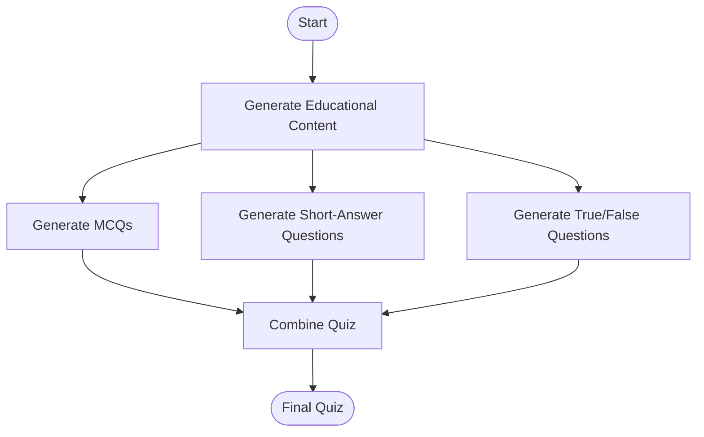

# LangGraph AI Quiz Generator

An AI-powered quiz generation workflow built with **LangGraph, LangChain, and OpenAI GPT-4o**. This project automatically creates educational content and transforms it into multiple-choice questions, short-answer questions, and true/false statements.

## Overview

Creating quizzes manually can be time-consuming for students and educators. This project automates the process using a graph-based workflow, where multiple question-generation tasks run in parallel and their results are combined into a structured quiz.

You provide a topic and the number of questions, and the workflow generates a complete quiz with answers.

## Features

- **Automated Content Creation:** Generates educational content based on a given topic.
- **MCQ Generation:** Creates multiple-choice questions with four options and one correct answer.
- **Short-Answer Questions:** Generates concise questions with answers.
- **True/False Questions:** Produces a balanced mix of true and false statements.
- **Parallel Execution:** Runs all three question-generation tasks concurrently using LangGraph.
- **Structured Outputs:** Uses Pydantic models to define and validate question formats.
- **Quiz Compilation:** Combines the generated questions into a single, organized quiz.
- **Customizable Input:** Allows you to specify the topic and number of questions.

## Tech Stack

- Python
- LangGraph
- LangChain
- OpenAI GPT-4o
- Pydantic
- python-dotenv
- Jupyter Notebook

## Workflow Architecture

The project uses a directed graph to coordinate the generation process.



### How It Works

1. **Input:** Specify a topic and the number of questions to generate.
2. **Content Creation:** GPT-4o generates educational material about the topic.
3. **Parallel Question Generation:** Three LangGraph nodes independently generate MCQs, short-answer questions, and true/false statements.
4. **Quiz Combination:** The workflow combines the generated questions into three organized sections.
5. **Final Output:** Displays the completed quiz, including questions, options where applicable, and answers.

## Project Structure

```text
langgraph-ai-quiz-generator/
├── main12.ipynb       # Main LangGraph implementation
├── .env               # OpenAI API key (not committed)
├── .gitignore         # Files excluded from Git
├── requirements.txt   # Project dependencies
└── README.md          # Project documentation
```

## Installation and Setup

### 1. Clone the Repository

```bash
git clone https://github.com/YOUR_USERNAME/langgraph-ai-quiz-generator.git
cd langgraph-ai-quiz-generator
```

Replace `YOUR_USERNAME` with your GitHub username.

### 2. Create a Virtual Environment

```bash
python -m venv .venv
```

Activate it on Windows:

```powershell
.venv\Scripts\Activate.ps1
```

On macOS or Linux:

```bash
source .venv/bin/activate
```

### 3. Install Dependencies

```bash
pip install langgraph langchain-openai python-dotenv pydantic ipython jupyter
```

### 4. Configure the API Key

Create a `.env` file in the project directory:

```env
OPENAI_API_KEY=your_openai_api_key_here
```

Replace the placeholder with your OpenAI API key. Never publish your actual API key on GitHub.

### 5. Run the Notebook

Start Jupyter Notebook:

```bash
jupyter notebook
```

Open `main12.ipynb` and execute the cells in order.

## Usage

The notebook accepts a topic and a question count through its initial state.

```python
initial = {
    "topic": "Artificial Intelligence",
    "num_questions": 4
}

result = workflow.invoke(initial)
```

To generate a quiz on another topic, update the `topic` value:

```python
initial = {
    "topic": "Machine Learning",
    "num_questions": 5
}

result = workflow.invoke(initial)
```

The final quiz is available through:

```python
result["final_quiz"]
```

The notebook displays the result as formatted Markdown.

## Learning Outcomes

This project demonstrates practical applications of:

- Building workflows with LangGraph's `StateGraph`.
- Defining shared workflow state using `TypedDict`.
- Connecting nodes using graph edges.
- Running independent tasks in parallel.
- Using structured outputs with Pydantic.
- Integrating OpenAI models with LangChain.
- Combining multiple LLM-generated results into one output.

## Future Improvements

- Add a web interface using Streamlit or Flask.
- Support PDF and document-based quiz generation.
- Allow users to select difficulty levels.
- Add quiz scoring and answer evaluation.
- Export quizzes to PDF or Word.
- Add retries and error handling for failed model calls.
- Let users choose the number of questions separately for each question type.

## Security

Store API keys in environment variables or a local `.env` file. Add `.env` and `.venv/` to `.gitignore` before pushing the project to GitHub.

## Disclaimer

Questions and answers are generated by an AI model and may contain inaccuracies. Review the generated quiz before using it for formal assessments.

## Author

Developed as a hands-on project to explore LangGraph, LLM orchestration, structured outputs, and parallel AI workflows.

If you find this project useful, consider giving the repository a star!
